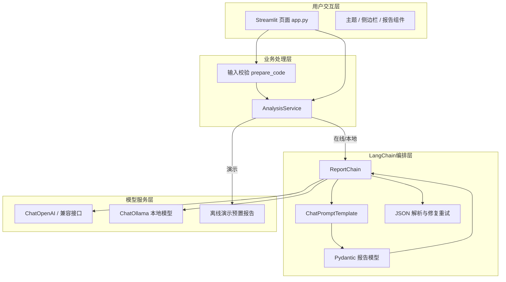
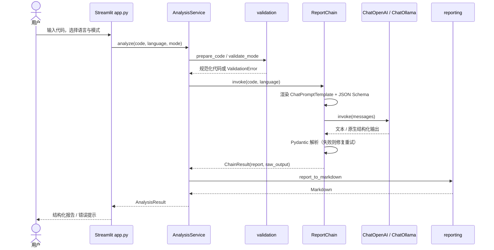

# CodeInsight 系统设计文档

> 版本：v0.1（第一轮开发）
> 对应需求：`CodeInsight_需求说明书.md`
> 技术栈：Python 3.10+、Streamlit、LangChain、Pydantic

---

## 1. 设计目标与范围

CodeInsight 将大模型能力组织为四类可复用分析流程：

1. **代码解释**：说明代码做什么、怎么执行、关键语句与输入输出；
2. **代码审查**：按严重程度列出潜在问题、原因、影响与修复建议；
3. **复杂度分析**：给出时间/空间复杂度、推导过程、假设与优化方向；
4. **测试用例生成**：覆盖正常、边界与异常场景，并给出预期结果。

设计目标：

- 输入、业务、编排、模型四层解耦，单层可独立测试；
- 模型输出必须经过 Pydantic 校验，避免格式漂移直接进入界面；
- 任何模型异常（超时、鉴权、非法 JSON）都不应导致页面崩溃；
- 无 API Key 时仍可完整演示界面与报告结构；
- 第一版不执行用户代码，降低安全风险与实现复杂度。

不在第一版范围内：用户登录、权限管理、多智能体、数据库持久化、自动执行代码。

---

## 2. 总体架构



| 层 | 主要文件 | 职责 |
|---|---|---|
| 用户交互层 | `app.py`、`ui/` | 会话状态、代码编辑、模式选择、报告渲染、复制/导出、错误提示 |
| 业务处理层 | `core/service.py`、`core/validation.py` | 校验、模式分发、计时、结果组装、Markdown 生成 |
| LangChain 编排层 | `core/prompts.py`、`core/chains.py`、`core/schemas.py` | 提示词、模型调用、结构约束、解析修复 |
| 模型服务层 | `core/llm.py`、`core/demo.py` | OpenAI 兼容接口、Ollama、离线演示 |

---

## 3. 模块设计

### 3.1 配置（`core/config.py`）

- 通过 `.env` / 环境变量构建不可变 `Settings`；
- `CODEINSIGHT_PROVIDER=auto` 时：存在 API Key → `openai`，否则 → `demo`；
- 校验非法 provider、数值参数、在线模式缺少 Key；
- 提供 `masked_api_key`，界面不展示完整密钥；
- 模型配置与业务逻辑解耦，测试可直接构造 `Settings`。

### 3.2 输入校验（`core/validation.py`）

处理顺序：空输入 → 超长输入 → 语言合法性 → 模式合法性。

- `normalize_code` 统一换行符，去掉首尾空行与行尾空白，保留缩进；
- 默认上限 20,000 字符，提示中包含实际长度与上限；
- `code_stats` 为界面提供行数与字符数；
- `validate_mode` 把字符串转为枚举，非法值给出可读提示。

### 3.3 报告模型（`core/schemas.py`）

四类 Pydantic 模型：

| 模式 | 顶层字段 |
|---|---|
| `ExplanationReport` | `overall_purpose`、`execution_flow`、`key_statements`、`input_output`、`algorithm_idea`、`assumptions` |
| `ReviewReport` | `summary`、`issues[]`（title/category/severity/location/snippet/reason/impact/suggestion/verification） |
| `ComplexityReport` | `time_complexity`、`space_complexity`、`confidence`、`derivation`、`assumptions`、`optimizations[]` |
| `TestReport` | `function_signature`、`assumptions`、`cases[]`（case_type/title/input/expected/purpose/notes）、`coverage_summary` |

设计要点：

- `extra="ignore"`：模型多输出字段不会导致失败；
- `str_strip_whitespace=True`：去除无意义空白；
- 枚举约束严重程度、置信度、用例类型；并通过 `_missing_` 兼容模型偶发的
  中文或大小写变体（如“严重”“中等”“边界”），非法值仍被拒绝；
- 数组长度约束：执行流程、关键语句、推导、用例不得为空；
- 字段描述会进入 JSON Schema，直接指导模型输出。

### 3.4 提示词（`core/prompts.py`）

每个模式包含：

1. 共享系统提示：角色、中文输出、只分析 `<code>`、不臆造、潜在问题措辞、JSON-only；
2. 独立的 `HumanMessage` 模板：语言、代码、模式任务、`format_instructions`；
3. 修复模板：携带错误信息与上次原始输出，要求重新输出完整 JSON。

提示词工程要点：

- **注入防护**：代码中的“忽略以上要求”等文字被明确视为数据；
- **不确定性**：复杂度信息不足时允许“不确定”，置信度设为 low；
- **可定位**：要求函数名、行号、原始片段，行号以第 1 行起算；
- **审查语气**：禁止把未经运行的判断表述为确定 Bug；
- **测试真实性**：禁止编造运行结果，预期结果必须由代码逻辑推导。

### 3.5 分析链（`core/chains.py`）

`ReportChain` 统一执行：

```text
format_messages
   →（可选）模型原生结构化输出
   → 文本 JSON 解析（PydanticOutputParser）
   → 成功：返回 ChainResult(report, raw_output)
   → 失败：追加修复消息 → 重新调用（默认 1 次）
   → 仍失败：ResultParseError（保留 raw_output）
```

异常映射：

| 场景 | 异常 | 用户提示 |
|---|---|---|
| 401 / 无效 Key | `ModelCallError` | 鉴权失败，请检查 API Key |
| 429 | `ModelCallError` | 请求过于频繁，请稍后重试 |
| 超时 | `ModelCallError` | 调用超时，可调大 `CODEINSIGHT_TIMEOUT` |
| 连接失败 / 404 | `ModelCallError` | 检查网络、Base URL 或模型名称 |
| 非法 JSON / 字段缺失 | `ResultParseError` | 格式不符合约定，已保留原始输出 |
| 空输出 | `ResultParseError` | 模型返回空内容 |

传输重试使用指数退避（`retry_backoff * 2^n * 0.5`）。
原生结构化输出失败时自动回退到 JSON 流程，兼容不同服务商。

### 3.6 业务门面（`core/service.py`）

`AnalysisService.analyze(code, language, mode)` 是界面唯一入口：

```text
开始计时
 → validate_mode + prepare_code
 → provider == demo ? 预置报告 : 构建/复用 ReportChain 并调用模型
 → report_to_markdown
 → AnalysisResult(mode, language, code, report, markdown,
                   provider, model, demo, elapsed_ms, created_at,
                   demo_sample_title, raw_output)
```

链实例按模式缓存，避免重复创建模型客户端。

### 3.7 离线演示（`core/demo.py`）

- 三份样例覆盖 Python / Java / C++，每份都包含四类完整报告；
- 报告与样例代码的行号、行为严格对应，并经过 Pydantic 校验；
- 代码与语言完全匹配时返回预置报告，并标注“未调用大模型”；
- 自定义代码或语言不匹配时抛出 `DemoNotAvailableError`，引导配置 API Key；
- 不伪装成模型分析结果，避免误导演示对象。

### 3.8 报告渲染（`core/reporting.py`、`ui/report_view.py`）

同一份结构化报告有两种消费者：

- **Markdown**：完整报告、代码围栏、表格、免责声明，供下载/复制；
- **Streamlit**：指标卡、有序步骤、问题折叠面板、测试用例 HTML 表格、原始 JSON。

针对模型输出做了以下处理：

- HTML 内容统一 `html.escape`，避免注入；
- Markdown 表格中的 `|` 与换行做转义；
- 代码围栏根据代码中反引号数量自动升级为四个反引号。

---

## 4. 典型数据流

### 4.1 在线分析



### 4.2 离线演示

```text
用户点击示例按钮
 → 示例代码与语言写入 session_state
 → 点击开始分析
 → AnalysisService(provider=demo).analyze
 → 规范化代码后查找内置样例
 → 返回对应模式的预置报告（明确标注“未调用大模型”）
```

---

## 5. 界面设计

- **单页完成主流程**：左侧输入、右侧报告；
- **输入区**：语言单选、三个示例按钮、代码编辑区、字符统计、模式单选、开始/清空；
- **报告区**：
  - 元信息：模式、语言、生成时间、耗时、provider/model、演示标记；
  - 三个标签页：结构化报告 / 复制导出 / 原始数据；
  - 结果过期检测：代码、语言或模式变化后提示并提供「重新分析」；
  - 错误区：错误摘要、可展开技术详情、模型原始输出、重试按钮；
- **侧边栏**：运行状态、配置指引、输入限制、温度/超时、隐私提醒、范围说明；
- **视觉**：深色渐变 Hero、浅色卡片、严重程度彩色徽章、等宽代码字体。

会话状态键：

| 键 | 用途 |
|---|---|
| `code_input` | 编辑区内容 |
| `language` | 当前语言 |
| `analysis_mode` | 当前模式枚举 |
| `last_result` | 最近一次成功的 `AnalysisResult` |
| `last_error` | 最近一次失败的异常对象 |

`AnalysisService` 通过 `st.cache_resource` 按 `Settings` 哈希缓存；模型客户端与链
跨 rerun 复用。

---

## 6. 安全与隐私设计

| 风险 | 措施 |
|---|---|
| API Key 泄露 | 仅服务端 `.env` 读取；界面只显示脱敏 Key；`.gitignore` 排除 `.env` |
| 超长输入 / 资源耗尽 | 20,000 字符上限；模型超时；重试次数可配置 |
| 提示词注入 | 代码置于 XML 标签内；系统提示明确禁止执行代码内指令 |
| XSS | 模型内容在 HTML 区域统一转义；普通内容使用 `unsafe_allow_html=False` |
| 任意代码执行 | 第一版不编译、不运行用户代码，仅生成测试用例 |
| 隐私数据外发 | 侧边栏显式提醒；演示模式不访问外网 |
| 输出误导 | 审查结论使用“潜在问题”措辞；界面固定免责声明 |

---

## 7. 错误处理策略

1. **输入错误**：前端即时提示 + 服务层再次校验；
2. **配置错误**：启动时捕获 `ConfigurationError`，展示修复指引后停止页面；
3. **模型错误**：封装为 `ModelCallError`，提供可操作建议；
4. **解析错误**：先自动修复，仍失败保留原文供排查；
5. **未知异常**：应用层兜底捕获，显示通用提示与技术详情，不崩溃；
6. **可恢复性**：失败后保留输入，提供“重试分析”；成功后修改输入可“重新分析”。

---

## 8. 测试设计

| 层次 | 测试文件 | 重点 |
|---|---|---|
| 输入 | `tests/test_validation.py` | 空/空白/超长/语言/规范化/模式 |
| 模型 | `tests/test_schemas.py` | 字段、枚举、行号、数组约束、多余字段 |
| 编排 | `tests/test_chains.py` | 正常 JSON、修复重试、空输出、超时、连接重试、原生输出回退 |
| 业务 | `tests/test_service.py` | 四模式分发、演示、缺 Key、解析失败、长度限制 |
| 演示 | `tests/test_demo.py` | 12 份报告、代码与行号一致、语言匹配 |
| 报告 | `tests/test_reporting.py` | Markdown 章节、表格转义、嵌套代码围栏 |
| 配置 | `tests/test_config.py` | auto/显式 provider、非法值、脱敏 |
| 界面 | `tests/test_app_smoke.py` | AppTest 端到端交互 |

需求测试编号 T-01 ~ T-10 的映射与结果见 [`测试报告.md`](测试报告.md)。

---

## 9. 配置与部署

- 单进程 Streamlit 应用，无额外数据库；
- 依赖见 `requirements.txt`；
- 主题配置 `.streamlit/config.toml`；
- 环境变量见 `.env.example`；
- 启动：`streamlit run app.py`；
- 若未来部署到公网：需增加身份认证、速率限制、HTTPS、服务端密钥管理，
  并考虑模型调用成本与内容合规。

---

## 10. 扩展点

| 扩展 | 建议实现位置 |
|---|---|
| 编译器/解释器语法检查 | `core/service.py` 前置检查模块，结果并入报告 |
| 本地模型切换 UI | 侧边栏写入 `Settings` 临时覆盖，重建缓存服务 |
| 分析历史（SQLite） | 新增 `core/history.py`，保存 `AnalysisResult` 元数据与 Markdown |
| 综合报告（一次四模式） | 新增 `analyze_all`，顺序/并行调用四个链并汇总 |
| 代码高亮编辑器 | 用 Monaco 组件替换 `st.text_area`，保留现有会话状态 |
| 更多语言 | 扩展 `SUPPORTED_LANGUAGES`、代码围栏映射与示例 |
| 更严格的输出校验 | 为字符串字段增加长度/格式约束，或在解析后做业务规则检查 |
| 多模型对比 | 增加 provider 配置列表，分别调用并并列展示报告 |
